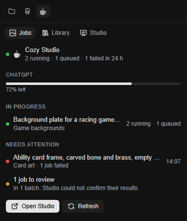

# Cozy Studio

See what your local [Cozy Studio](https://github.com/gvastethecreator/cozy-studio)
is doing without leaving Ghostex: image jobs in progress, failed batches, jobs
to review, your ChatGPT usage and the Library images that still have no tags or
collection. On Windows it also starts, restarts and stops Studio, and can keep
it running. Ghostex draws
it with its own rows, so it matches both themes and also shows on the Ghostex
phone app. Needs Ghostex 11.8 or newer and Cozy Studio 0.3.0 or newer on this
computer: the clean Stop, the disk and database figures and stuck jobs come
from that release.



## What it shows

- **Section above your projects**: one Cozy Studio row with what is happening
  now ("2 running · 1 failed in 24 h"). The dot is green while jobs run, red
  after a failure and yellow when Studio's Agent access is off. Click it to
  open Studio.
- **Cozy Studio mode** (its button in the sidebar's top row) and **side
  panel** (pick Cozy Studio in the side panel's view list), with three tabs:
  - **Jobs**: the ChatGPT usage (the share of the usage window left, or a
    warning when jobs spend credits or the usage is used up), jobs in progress
    grouped by batch, batches that failed in the last 24 hours, and how many
    jobs Studio could not confirm and needs you to review. Click a row to open
    that batch or job in Studio, or the review row to open the jobs to review.
    Studio 0.2.0 and older open the workspace instead. Jobs that run with no
    update for 30 minutes show as stuck, and buttons open the review list or
    the stuck job in Studio.
  - **Library**: each workspace with images that have no tags or collection.
    Click one to open Studio on its unorganized images. Its menu has
    **Organize with an agent**, which opens a new agent in your Cozy Studio
    project with a prompt ready to send (it is not sent for you). The agent
    uses the `cozy-studio-mcp` skill and asks before it changes anything.
  - **Studio**: version, Agent access level (Read only, Organize or Full
    control) with what it lets agents do, ChatGPT sign-in, and the free space
    on the Library's disk with the database's size and schema version (yellow
    below 10 GB free, red below 2 GB). **Updates** lists the new commits and has
    **Check for updates** and **Update and restart** (see
    [Updating Studio](#updating-studio)). **Recent errors** shows the newest
    errors in Studio's log with their time. Under **Workers**: how many of Studio's workers are busy, how
    many jobs wait in the queue, and each provider with work against its own
    limit ("ChatGPT 3/8 · 2 waiting"). It warns when provider dispatch is on
    hold (Studio started with `STUDIO_HOLD_PROVIDER_DISPATCH=1` and leaves the
    jobs it found at startup waiting) and when the Codex app-server is running,
    because jobs on it spend Codex usage.
- **Refresh** reads everything again (at most once every 20 seconds).
- **Start, Restart and Stop** (Windows): the Studio tab and the menu of the
  Cozy Studio row start Studio while it is down, and restart or stop it while
  it runs. See [Starting and stopping Studio](#starting-and-stopping-studio).
- **Keep Studio running** (Windows): a switch on the Studio tab that starts
  Studio again when it goes down, with the list of times Studio was down. See
  [Keeping Studio running](#keeping-studio-running).
- **Studio's log** and **Logs folder**: open the file Studio writes its output
  to, and the folder with Studio's own logs.

Apart from Stop, Restart, Update and Keep Studio running, which end or rerun
the jobs Studio has in flight, the extension never starts, retries or cancels
jobs, changes settings or touches Library files. It reads Studio's logs.

Ghostex's extension API has no notifications or toasts (an extension can only
draw its panel and handle its taps), so the panel shows finished batches and
failed jobs but does not pop up a notice.

## Starting and stopping Studio

On Windows, the panel controls a Studio that runs from its Git checkout with
`bun run dev` (`scripts/dev.ts`):

- **Start** runs `bun run scripts/dev.ts` in Studio's folder through Windows'
  process service. Studio gets a hidden console of its own, outside Ghostex and
  any terminal, so it keeps running after Ghostex or an agent session closes,
  and a Ctrl+C in another terminal does not reach it. Its output goes to
  `logs\dev-restart.log` in Studio's folder. Start refuses while Studio
  answers, while anything listens on Studio's ports (17222 and 17223) or while
  a Studio process still runs, so there are never two Studios on one Library.
  Start needs [Bun](https://bun.sh): it uses `bun.exe` from `BUN_INSTALL`,
  then from Bun's default install folder (`.bun\bin` in your user folder),
  then from `PATH`.
- **Restart** asks Studio to restart itself when its launcher allows it (Studio
  started with `bun run dev` and no jobs in flight). Otherwise it stops and
  starts Studio.
- **Stop** asks Studio to shut down the way Ctrl+C does (`POST
  /api/updates/stop`, in Studio 0.3.0 or newer): it records the jobs it
  interrupts and stops what it started, and its launcher ends the UI. If Studio
  is still up 15 seconds later, or has no such route, Stop ends Studio's
  process tree: the `scripts/dev.ts` launcher above the backend on port 17223
  and the UI on port 17222, with their children. It finds them by port and
  command line and never ends another program on those ports.
- With jobs running or queued, Stop and Restart ask first. Studio runs those
  jobs again when it starts, which can spend provider usage again.
- **Open Studio** opens the UI dev server (`http://127.0.0.1:17222`) while it
  runs, and Studio's backend address otherwise.

The panel learns Studio's folder from a running Studio's health check and keeps
it in the extension's data folder, so Start appears after Studio has run once
while the extension was on. On macOS and Linux the panel shows Studio but does
not start or stop it.

## Keeping Studio running

**Keep Studio running** on the Studio tab (Windows) is off until you turn it
on, and stays as you left it when Ghostex restarts. While it is on:

- Every 30 seconds the panel checks that something listens on Studio's port, a
  plain connection that costs Studio nothing.
- Studio counts as down when two checks 15 seconds apart find nothing on its
  ports and its health check does not answer. Then the panel starts Studio the
  way **Start** does, with the same checks, so it never starts a second Studio.
  Studio's own restart (after an update or Restart) keeps its launcher and UI
  running, so it never counts as down.
- Starts wait longer each time: 30 seconds, then 1, 2 and 5 minutes. After 3
  failed starts in a row within 10 minutes the panel stops trying and shows the
  error. Tap the switch or **Start** to try again.
- **Stop** in the panel pauses it until the next **Start** or until you tap the
  switch. Stopping Studio any other way, such as Ctrl+C in its terminal, counts
  as going down, so the panel starts it again.
- Each time it finds Studio down, the panel keeps the time in `keeper.json` in
  the extension's data folder and copies the end of Studio's output and of its
  error log to `outages\` there, before the new start writes more. The Studio
  tab lists the last 20 ("Down at 23:41 / Started again at 23:42") with how
  many times in the last 24 hours; tap one to open the logs kept then.
- Only one server keeps Studio running. The server exits within 5 seconds when
  the Ghostex that started it goes away, and the server that keeps Studio
  running holds `keeper.lock` in the extension's data folder. Another server
  waits and takes the lock over when that server or its Ghostex is gone.

Studio runs the jobs it had in flight again when it starts, which can spend
provider usage again.

## Updating Studio

The **Updates** block reads Studio's update status (`GET /api/updates`): the
new commits on `main`, or the new version on the releases channel. **Check for
updates** asks Studio to check again (`POST /api/updates/check`, as Studio's
Settings do). **Update and restart** appears when Studio says it can update
(`POST /api/updates/apply`): Studio fast-forwards its checkout, installs
dependencies and restarts itself through `bun run dev`. Studio refuses while
its checkout has local changes, and the block shows its reason instead of the
button. With jobs queued or running, Studio 0.3.0 or newer offers **Update
anyway** (`canForceUpdate`). The panel then asks first and says how many jobs
the update interrupts. When you confirm, it sends `force: true`, and Studio's
restart puts the running jobs back in the queue. After the restart Studio
resumes them along with the queued ones. A job that already sent its request
to ChatGPT goes to Review instead of sending it again. Studio 0.2.0 and older
refuse while jobs are in flight.

## Studio's logs

**Studio's log** opens the file Studio writes its output to: the one its launch
command names (`logs\dev-restart.log` for a Studio this panel started, or the
file in a command such as `cmd /c "bun run scripts/dev.ts > x.log"`). Without
one it opens Studio's own logs folder (`.studio\logs` in the Library), which
**Logs folder** always opens. Files open with their default app and folders in
Explorer.

## Setup

1. Run Cozy Studio. Studio writes the port it listens on to `server.json` in
   its data folder (`%LOCALAPPDATA%\Cozy Studio` on Windows,
   `~/Library/Application Support/Cozy Studio` on macOS,
   `~/.local/share/cozy-studio` on Linux), and the extension reads it before
   each call, so it finds Studio on another port too. Without the file it uses
   `http://127.0.0.1:17223`, Studio's default address.
2. In Studio, keep **Settings > Advanced & maintenance > Agent access** at
   Read only or higher. The extension reads Studio through the same read-only
   tools agents use, so Studio's Agent access governs it: at Off, the panel
   asks you to turn it on.
3. Install the extension from **Settings > Extensions** in Ghostex.

If Studio is not running, the panel says so and follows Studio again within 30
seconds of its start.

## How it stays light on Studio

With Cozy Studio 0.3.0 or newer:

- The jobs summary (`studio_jobs` with `summary: true` through
  `POST /api/mcp/call`, about 2 KB: counts, batches in progress, failures of
  the last 24 hours) at start, every 10 minutes, after the stream reconnects,
  and 3 seconds after a job changes state. Changes that arrive together share
  one read; progress events cause none.
- Studio's agent event stream (`GET /api/agent/events`) says when jobs change.
  It follows Agent access: Studio ends it when the user turns Agent access off.
- `studio_status` (ChatGPT usage, unorganized images, version) at start, every
  10 minutes, after a sign-in change and on Refresh.

Studio 0.2.0 and older have no summary, so the extension falls back to one full
jobs snapshot (`studio_jobs`, about 200 KB) at start and every 10 minutes,
applies Studio's UI event stream (`GET /api/events`) to it, and reads provider
readiness (`GET /api/readiness`) every 5 minutes and `studio_status` every 30.

With any Studio, the worker pool (`GET /api/health`, about 1.5 KB) at start,
every minute while jobs run or wait, every 10 minutes when Studio is idle, and
3 seconds after a job changes state. Also Studio's update status
(`GET /api/updates`) and its newest errors (`GET /api/logs?level=error&limit=10`)
every 10 minutes, about 1 KB each. These are plain HTTP, which does not check
Agent access, so the extension skips them while Agent access is off.

Either way, one call runs at a time, each with a 30-second timeout. A call that
times out is tried again after 2 minutes; the panel keeps what it last read.

## Preferences

None.

## Permissions

- `network`: reads Cozy Studio's local HTTP API on `127.0.0.1` (port 17223, or
  the one Studio's `server.json` names). It makes no other network requests
  besides the scoped local Ghostex API.
- `agents.start`: **Organize with an agent** opens a new agent with a draft
  prompt. Nothing is sent until you send it. Until you allow it in Settings >
  Extensions, the panel leaves that action out and says how to allow it.

The extension runs a small Node.js server while it is on. The server is not
sandboxed, and Ghostex shows this when you install the extension. It uses only
Node.js built-ins and has no dependencies. Besides the network, it reads
Studio's `server.json` and Studio's logs, and keeps Studio's folder, the Keep
Studio running state and the logs of each outage in its own data folder. To start, restart and stop Studio it runs
Windows' own tools (PowerShell for the process list and the start, `taskkill`
for the stop), only when you tap those buttons or, with Keep Studio running on,
when Studio is down. To open a log it runs Explorer. No Ghostex permission covers this: Ghostex checks permissions on its
own API and panel actions, and these buttons send the tap back to the server.

## Development

`dist/server.mjs` is a byte-identical copy of `src/server.mjs`:

```sh
cp src/server.mjs dist/server.mjs
node --check dist/server.mjs
node tooling/validate.mjs extensions/cozy-studio/ghostex-extension.json
```

To develop against another Studio, set `COZY_STUDIO_URL` (for example
`http://127.0.0.1:17300`) in the server's environment. Ghostex does not set it.
`COZY_STUDIO_DIR` names Studio's folder for Start. `STUDIO_SERVER_PORT`,
`STUDIO_UI_PORT` and Studio's other `STUDIO_*` variables, and `LOCALAPPDATA`,
change the ports the panel checks and carry over to the Studio it starts, so a
test Studio can run with its own ports, data folder and Library. For such a
test Studio, `COZY_STUDIO_LOG` names its log file, and
`COZY_STUDIO_SEPARATE_LIBRARY=1` lets Start run while another Studio's
processes run on other ports; Start still checks its own ports.
