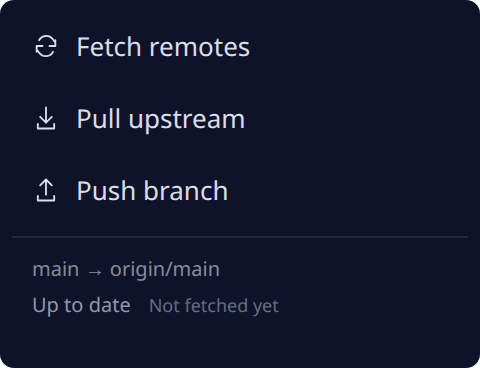

# Branch Graph · Quick actions

Fetch, fast-forward pull, and push the active Ghostex project's branch from a
compact titlebar popup. It works independently and can be pinned beside
**Branch Graph** for convenient access.



## Setup and behavior

Requires Git, Node.js 20 or newer, and Ghostex's v1 extension bridge. Linux
x86_64 with Ghostex 10.45.0 is the verified platform; other platforms have not
been tested. Install it from the extension store, grant command access, and
pin it to the titlebar. Its declared placement is a 240×184 popup, with scrolling
for longer status/error messages. No extension-owned server or runtime npm
installation is needed.

The popup follows `ghostex.context().project.path`, including linked worktrees.
It displays the branch and upstream, cached ahead/behind counts, and last
fetch time. Reopen it to refresh status. It has no automatic background fetch
and no configurable preferences. All network actions require a button click.

| Action | Behavior |
| --- | --- |
| Fetch remotes | Update refs from configured remotes without changing HEAD or checked-out files. |
| Pull upstream | Fetch the configured upstream, then fast-forward. Refuse dirty worktrees, ongoing operations, diverged histories, and deleted upstreams. |
| Push branch | Push the displayed commit to its configured upstream branch using one explicit refspec, without force or accompanying tags. |

Pull/push require a checked-out branch with an existing remote upstream.
Branch/upstream state is rechecked before writes. A shared lock serializes
Branch Graph actions across the graph, this popup, and linked worktrees.
Authentication uses existing Git credentials and the SSH agent. Interactive
prompts are disabled; configure credentials in your terminal before retrying
an error. Network operations time out after 45 seconds.

Native glass and combined split-pill styling are optional features of the
separate Linux adapter in the
[source project](https://github.com/knutpfr/ghostex-branch-graph#glass--compatibility).
They are not installed by this catalog package. The popup works on the stock
renderer and does not depend on the graph extension being installed.

## Permissions and local data

The sole requested permission is **exec**. It runs the bundled Node helper in
the active project's directory and invokes Git with argument arrays. The
helper allowlists graph, details, status, fetch, pull, and push; this popup
uses status/fetch/pull/push. Command access is granted to the extension as a
whole, and spawned processes are not restricted by other bridge permissions.

Git operations use your existing Git configuration and contact configured
remotes. Fetch writes remote-tracking refs, pull can update files, and push
sends committed changes. There is no network bridge use, analytics, remote
code loading, or executable download.

The helper reads Ghostex's local `native-sidebar-settings.json` and returns
only allowlisted appearance fields for theme matching. Other settings are
not returned to the page or stored. Remote-machine projects are not supported.

## Reproducible build and checks

From this extension directory:

```sh
npm ci --ignore-scripts
npm test
npm run build
```

There are no npm dependencies. The build copies the popup's reviewed source
assets and serializes `src/repository.mjs` into `dist/helper-source.mjs`;
a clean build matches committed `dist/` byte-for-byte. It uses the same helper,
bridge, remote controls, theme, and popup UI as the source project's 0.6.0
release. Only the popup files are bundled; the graph UI is not duplicated.

Tests use disposable repositories and local bare remotes to cover branch,
merge, Unicode, worktree, fetch, pull, push, and refusal/locking behavior.
The graph/popup UI integration check is available in the
[source project](https://github.com/knutpfr/ghostex-branch-graph).

From the catalog root:

```sh
node tooling/validate.mjs
node tooling/verify-dist.mjs
node tooling/build-catalog.mjs
```

## Source and license

Created by [knutpfr](https://github.com/knutpfr). Source project:
[ghostex-branch-graph](https://github.com/knutpfr/ghostex-branch-graph).
MIT licensed; see [LICENSE](LICENSE) and
[third-party notices](THIRD_PARTY_NOTICES.md) for Ghostex-derived theme
calibration. This is an independent extension.
