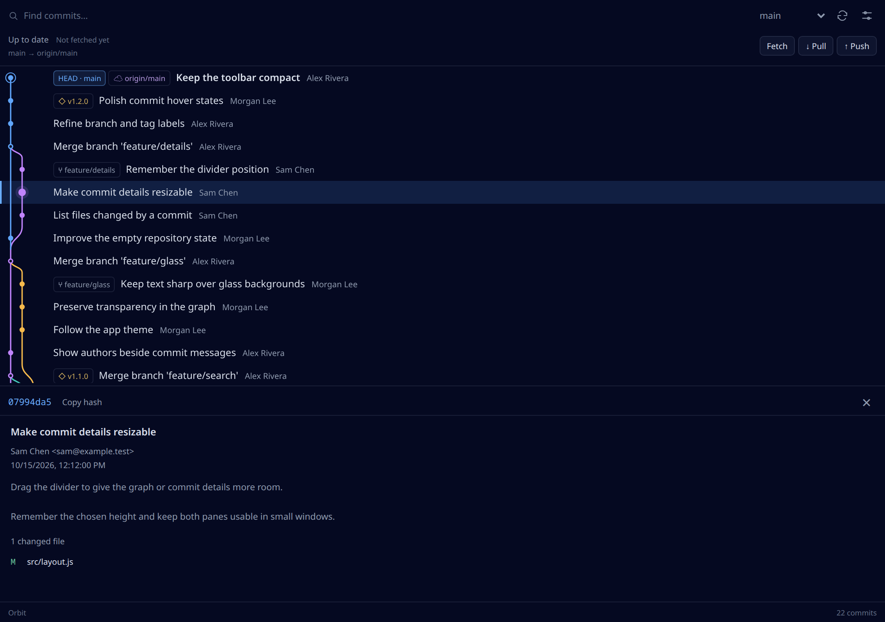
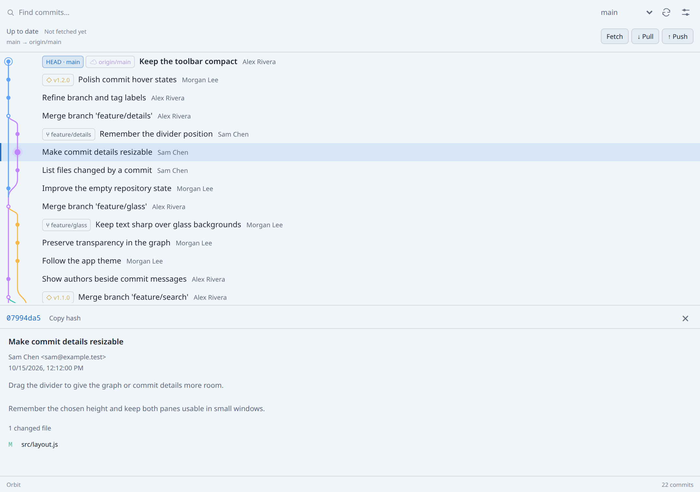
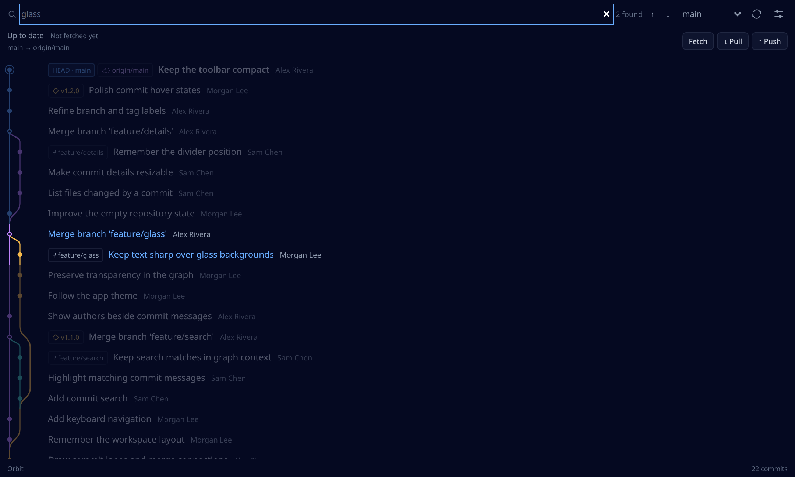
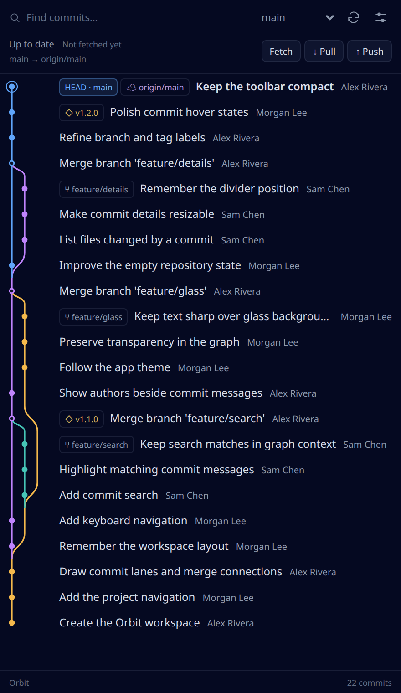

# Branch Graph

A compact Git graph beside your Ghostex agents. Trace merges, inspect commits,
check your upstream, and sync the active project without leaving your workspace.



## Features

- Follows the active local project, branch, and linked worktree.
- Colored merge lanes, HEAD, local and remote branches, and tags.
- Search messages, authors, hashes, and refs while preserving graph context.
- Inspect full commit messages, authors, dates, hashes, and changed files.
- Switch between current-branch history and all branches without checking out.
- Load history in batches of 250, up to 5,000 commits, with virtualized rows.
- Resize the commit-details pane; its height is remembered.
- Upstream ahead/behind counts and the time of the last fetch.
- Optional background fetch, plus explicit Fetch, fast-forward Pull, and Push.
- Dark and light palettes follow Ghostex.





## Setup

Requires Git, Node.js 20 or newer, and Ghostex's v1 extension bridge. Linux
x86_64 with Ghostex 10.45.0 is the verified platform; other platforms have not
been tested. Install Branch Graph from the extension store, grant command
access, and open it from the View panel's **+** menu. Pin it to the titlebar
if desired. No runtime npm installation or extension-owned server is needed.

This package works on the stock renderer. Real desktop glass/blur and the
native split-pill styling require the separately installed, optional Linux
adapter from the [source project](https://github.com/knutpfr/ghostex-branch-graph#glass--compatibility).
The catalog package does not install native hooks or alter Ghostex launchers.

The optional **Branch Graph · Quick actions** extension provides a separate
Fetch/Pull/Push popup. The graph's own actions work without that companion.

## Preferences

Preferences are available in the graph's settings menu and stored through
Ghostex's extension settings/storage APIs.

| Preference | Default | Behavior |
| --- | --- | --- |
| Automatic refresh | On | Refresh local history every five seconds while visible. |
| Fetch remotes every minute | On | Fetch configured remotes approximately once a minute while visible; never automatically pull or push. |
| Transparency and app tint | On | Follow Ghostex's theme/tint. Actual alpha depends on the renderer; the stock Linux renderer can remain opaque. |

## Remote actions

**Fetch** updates remote-tracking refs without changing checked-out files or
HEAD. **Pull** fetches the configured upstream, then fast-forwards; it refuses
dirty worktrees, ongoing Git operations, diverged histories, and deleted
upstreams. **Push** sends the displayed commit to the configured upstream
branch using one explicit refspec, without force or accompanying tags.

Ahead/behind counts use cached refs. Background fetch runs only while the graph
is visible and can be disabled. Pull and push require a checked-out branch
with an existing remote upstream and run only when clicked. The helper rechecks
branch/upstream state before changing anything, and serializes actions across
linked worktrees and the optional quick-actions popup with a shared lock.

Authentication uses existing Git credentials and the SSH agent. Interactive
prompts are disabled; authentication failures are shown in the UI. Configure
credentials in your terminal before retrying. Network operations time out
after 45 seconds. Force pushes, commits, branch creation, stashing, and conflict
resolution remain terminal workflows.

## Permissions and local data

The sole requested permission is **exec**. It runs the bundled Node helper in
`ghostex.context().project.path`, including active worktrees, to invoke Git
with argument arrays. The helper allowlists graph, details, status, fetch,
pull, and push operations. Command access is granted to the extension as a
whole; a spawned process is not restricted by other bridge permissions.

History reads use local Git data. Git fetch/pull/push contact your configured
remotes using your existing Git configuration and credentials; pull can update
files, and push sends committed changes. The page does not use the network
bridge, load remote scripts, download code, or send analytics.

For theme matching, the helper reads Ghostex's local
`native-sidebar-settings.json` and returns only an allowlist of appearance
fields. Other app settings are not returned to the page or stored. Preferences
and divider height use extension storage. Remote-machine projects are not
supported. Shallow clones display only available local history; loading more
rows does not fetch from the network.

## Keyboard

| Key | Action |
| --- | --- |
| Ctrl/Cmd+F or / | Focus search |
| Enter / Shift+Enter | Next / previous search result |
| Up / Down outside inputs | Select the adjacent commit |
| R | Refresh |
| Escape | Clear search, then close details |
| Up / Down on the divider | Resize details; Shift makes larger steps |
| Home / End on the divider | Smallest / largest details pane |

## Reproducible build and checks

From this extension directory:

```sh
npm ci --ignore-scripts
npm test
npm run build
npm run test:ui
```

The build copies reviewed assets from `src/` and serializes
`src/repository.mjs` into `dist/helper-source.mjs`. It also builds the
`dist/quick/` assets from the same source, allowing the graph and popup to be
tested together. The committed `dist/` rebuilds byte-for-byte. Runtime code
uses only browser APIs, Git, and Node built-ins. Playwright Core 1.64.1 is an
exactly pinned, development-only dependency for UI checks.

Unit/integration checks cover graph lanes, merges, Unicode metadata, worktrees,
and real Git fetch/pull/push with disposable local remotes. UI checks exercise
the actual graph and popup, automatic fetch, and project changes during an
action. They require Chrome at `/usr/bin/google-chrome` or `CHROME_PATH`.
Screenshots use fictional demo data.

From the catalog root:

```sh
node tooling/validate.mjs
node tooling/verify-dist.mjs
node tooling/build-catalog.mjs
```

## Source and license

Created by [knutpfr](https://github.com/knutpfr). Source project:
[ghostex-branch-graph](https://github.com/knutpfr/ghostex-branch-graph).
MIT licensed; see [LICENSE](LICENSE) and
[third-party notices](THIRD_PARTY_NOTICES.md) for the Ghostex-derived theme
calibration. This is an independent extension.
